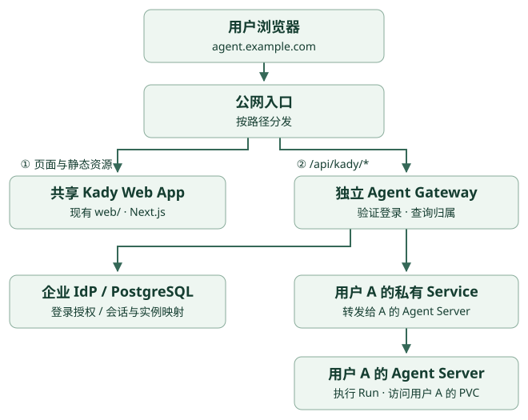

# K-Dense 多用户部署方案：Agent Gateway

**状态：架构提案。** 首期面向单个 Kubernetes 集群。所有用户共用一套 Next.js 前端和一个独立部署的 Agent Gateway 服务。每位用户拥有一个私有、常驻的 Agent Server 和独立持久化空间。Gateway 可以单独发布、重启和扩容。现阶段无需再拆分 Portal 和 Core。

## 1. 部署拓扑与一次请求

① 打开页面时，入口从共享 Web App 取得界面。② 点击发送后，浏览器发起另一条请求，由入口送到 Gateway，再转给当前用户的 Agent。回答以 SSE 沿第二条路径返回浏览器。图中以用户 A 为例，其他用户各有自己的 Service、Agent Server 和存储。登录回调也由入口转给 Gateway。

**现有 Web App 与 Next.js 的关系。** 仓库里的 `web/` 就是用户操作 Kady 的 Web App，Next.js 是构建和运行这个界面的框架。“共享部署”指把现有界面部署一套供所有用户访问。每个用户单独运行的是 `server/` 后端。第 5 节所说的“应用访问”指用户让 Agent 生成的交互式网页，例如科研报告，属于项目产物。

“同源”指浏览器访问网页和 API 时使用相同的协议、主机名和端口。用户打开 `https://agent.example.com/chat` 后，页面调用 `fetch("/api/kady/projects")`，浏览器访问的就是同一域名下的 API。公网入口按路径直接转发给相应服务，API 请求无需经过 Next.js。

托管版前端构建时将 `NEXT_PUBLIC_ADK_API_URL` 设为 `/api/kady`。例如，登录用户提交 `POST /api/kady/sessions/:id/run` 后，Gateway 验证会话和授权，按用户归属选定 Agent，去掉公网前缀，再向该 Agent 转发 `POST /sessions/:id/run`。当前单端口部署在 [web/server.mjs](../web/server.mjs) 中使用同一前缀代理到固定后端；托管版由入口和 Gateway 接管这条路径。

## 2. 组件与状态归属

| 组件 | 负责什么 | 保存什么 |
|---|---|---|
| Next.js | 提供聊天、文件和设置界面，调用同源 API | 前端构建产物 |
| Agent Gateway | OIDC 登录、注销、会话校验、授权、实例查询、HTTP/SSE 代理 | 通过中心库保存身份、登录会话和实例映射 |
| Agent Provider | 解析私有端点，后续支持创建、升级、启停 | Provider 专属的部署引用和运行状态 |
| Agent Server | 管理项目和对话，执行工具与 Run，提供流式输出和恢复接口 | 用户的科研数据、对话、执行记录、模型凭证和个人配置 |

**登录 Session** 由 Gateway 创建和撤销。**对话 Session** 由 Agent 创建和恢复，可以跨多次登录持续存在。退出登录会撤销浏览器的访问权；已经开始的 Run 有独立的取消操作。浏览器提交的项目标识和对话 ID 仅在选定的 Agent 内生效。

## 3. 身份、实例注册与授权

1. Gateway 对接企业 OIDC，使用验证过的 `(issuer, subject)` 映射内部用户 ID。浏览器持有仅限主站的 Secure、HttpOnly 会话 Cookie。对写操作实施 CSRF 防护。首期可用 PostgreSQL 同时保存会话与注册表。
2. 注册表分别记录用户归属（用户 ID、Agent ID）和部署信息（Agent ID、Provider、部署引用）。首期对用户和 Agent 的归属分别设置唯一约束。Kubernetes 引用包含集群、命名空间、Service 名和端口，使用稳定的 Service DNS。实例未登记或尚未就绪时，返回相应错误。
3. Gateway 仅从受控注册表选择端点，剥离外部身份头和网关登录凭证，通过 TLS 向选定实例发送短期签名令牌。Agent 验证签发者、签名、有效期，并将令牌的 `aud`、`sub` 分别与部署时配置的自身 Agent ID、所属用户 ID 比对。即使路由记录误指向其他用户，接收方也能拒绝请求。签名私钥仅由 Gateway 持有。
4. Agent 使用私有 Service。集群采用默认拒绝的网络策略，显式开放网关入站和 DNS、模型服务等所需出站，并核实网络插件执行策略。Agent 只挂载本用户存储，配置 CPU、内存限制，关闭不需要的 Kubernetes 服务账号令牌挂载。未来负责部署的 worker 单独获得所需集群写权限。

## 4. 持久化与断线恢复

Pod 重建后的成功标准是用户能打开旧对话，并继续用已配置的模型发送消息。只恢复聊天文件无法满足第二项。

| 数据 | 当前存放位置 | 托管部署要求 |
|---|---|---|
| 项目、对话、产物、成本账本、任务记录 | `projects/` 及各项目 sandbox | 每用户持久化 `KADY_PROJECTS_ROOT`，升级时保证单一 Agent 进程写入 |
| Pi OAuth 凭证、个人默认设置、全局技能 | 默认 `~/.kady/pi-agent/` | 将有效 Pi 用户目录指向该用户的持久化空间，限制凭证文件权限 |
| Settings 保存的模型密钥与服务配置 | 当前凭证接口默认写仓库根目录 `.env` | 为每用户提供可写且持久的配置位置；若调整路径，同时适配启动加载与 Settings 的写入、更新和清除 |

**说明：Pi 用户目录为什么要持久化？** Pi 是 Kady 后端用来运行 Agent 和调用模型的 SDK。默认目录 `~/.kady/pi-agent/` 保存以下三类内容，供同一用户的多个项目复用。

| 内容 | 用途 | Pod 重建时丢失的影响 |
|---|---|---|
| 供应商 OAuth 凭证（`auth.json`） | 用户在 Settings → Providers 登录模型供应商后，Pi 使用保存的凭证调用该供应商的模型。 | 企业 SSO 仍可用于登录 Kady，但用户可能要重新连接模型供应商才能继续对话。 |
| 个人默认设置（`kady-settings.json`） | 保存 Settings → Defaults 中的默认模型、思考级别等偏好。 | 新项目的第一个聊天标签页可能回到系统默认值。已保存在项目中的对话记录仍可恢复。 |
| 全局技能（`skills/`） | 让同一用户的多个项目复用操作说明和配套文件，例如自定义的数据分析流程。同名时优先使用项目技能。 | 新会话无法加载丢失的用户级技能。保存在项目持久卷中的技能仍可使用。 |

这里的“全局”仅指当前用户的 Agent 环境。每位用户应有自己的 Pi 用户目录，避免共享模型凭证或个人配置。

这些目录可以共用一个用户专属 PVC 的不同子目录。若凭证改存专用密钥服务，必须接通 Settings 的读写与撤销流程。Pi 的供应商授权与 Gateway 的企业登录分别管理。

Gateway 流式转发 SSE 和文件上传下载。公网入口和 Gateway 均需配置流式响应、合适的空闲超时及上传大小限制。浏览器断线后按现有协议查询 `/sessions/:id/run/state` 并接回原 Run；Gateway 禁止自动重发启动 Run 的 POST。网络断线恢复与 Pod 故障恢复分别验收：持久卷可恢复已落盘的数据，进程内执行中的 Run 仍可能中断。网关日志仅记录诊断所需的请求标识、结果和耗时，避免记录正文、Cookie 和模型凭证。

## 5. 分阶段实施

| 阶段 | 交付范围 |
|---|---|
| 1 · 基础 Gateway | 用 Fastify + TypeScript 独立部署 Gateway，接入企业 OIDC、PostgreSQL、私有 Service 和 HTTP/SSE 代理。手工部署并登记常驻 Agent。 |
| 2 · 自动部署 | 独立 worker 通过 Kubernetes Provider 管理工作负载、Service 和 PVC，以期望状态驱动重试和恢复。区分停机、删除计算实例和清除用户数据。 |
| 3 · 应用访问 | 为 Agent 生成的交互式网页提供隔离来源、应用授权，以及需要的 WebSocket 转发。主站 Cookie 仅限主站。 |
| 4 · Control Plane | 加入按需唤醒、配额、计量、多集群与其他 Provider。在线状态只作为调度参考。 |

**网页隔离从支持可执行内容时生效。** 首期允许生成的 HTML 下载、查看源码或在禁用脚本的沙箱中预览。若首期就要执行用户生成的脚本，应同步提供隔离来源，防止脚本借用主站会话访问科研数据。

**缩容需要排空协议。** 停机前先阻止新的 Run 和后台任务进入，再检查活跃执行、持久任务回收和定时唤醒责任。只有任务已完成或可恢复、需要的唤醒已交给外部调度器时，才将副本数降到零。升级同样应避免新旧进程同时写入用户状态。

## 6. 首期验收

- 两个用户从同一域名登录，使用相同项目名时仍只看到各自的数据。故意把 A 的路由指向 B，B 拒绝请求。
- 通过真实公网入口上传文件、启动 Run、逐步收到 SSE、下载结果。断线重连后接回同一个 Run，只产生一次执行。
- 替换用户 Pod 后，旧对话、文件、技能和模型配置可用。更新或清除凭证后再次重建，验证新值生效、旧值不会恢复。
- 注销后旧登录会话无法发起新请求。重新登录后可以查看原对话及后台任务状态。
- 验证用户 Pod 之间的网络访问和卷挂载符合隔离策略。生成的网页无法借主站登录会话调用科研 API。
